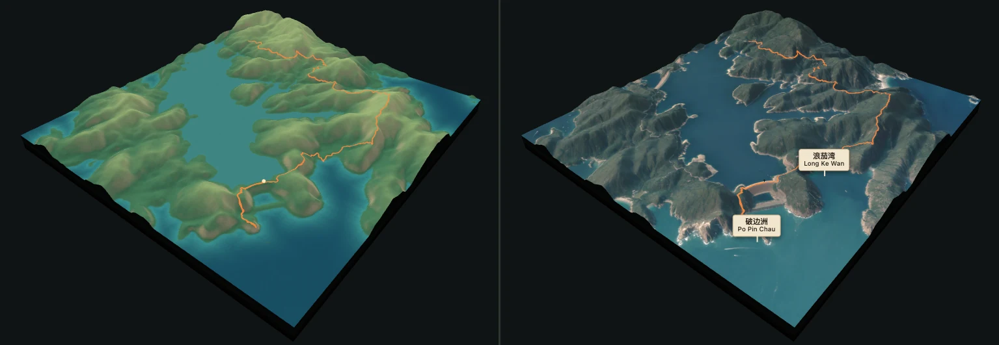

<div align="center">

<h1>Contour Memoir · 山行纪</h1>

<p><strong>把走过的路线，留成一座可以重访的 3D 沙盘。</strong></p>
<p>导入 GPX 或 Trail JSON，查看路线高程、切换平面和 3D，沿着轨迹重走一程。</p>
<p>GPX / Trail JSON · React / Three.js · 浏览器本地处理</p>
<p><a href="https://lihao-coding.github.io/shanxingji/">体验基础版</a> · <a href="https://lihao-coding.github.io/shanxingji/?edition=studio">体验进阶版</a> · <a href="#使用">导入路线</a></p>

</div>

<p align="center"></p>

## 两种麦理浩径示例

两个示例共享同一条简化轨迹与同一块高程地形，首页可以直接切换。

| | 基础版 · 地形与路线 | 进阶版 · 实景与沿途记忆 |
| --- | --- | --- |
| 地形 | Copernicus DEM、平面 / 3D、缩放与巡览 | 同一份地形，可切换高清航片与地形着色 |
| 回放 | 轨迹进度、沿线飞行、山海光影 | 增加随轨迹移动的 GLB 徒步人物，可单独聚焦 |
| 沿途内容 | 里程与地形高程 | 破边洲、浪茄湾照片点位，打开照片时可跳到对应路段 |
| 离线 | 页面、路线与地形 | 离线示例包也包含航片、照片与人物模型 |

### 可拓展的功能

- **正射航片**使用覆盖整块沙盘的拼接影像，万宜水库东坝叠加更细的局部影像。演示贴图约为全景 2.75 米/像素、东坝 0.65 米/像素。
- **照片点位**由景点邻近的路线位置驱动，配套图集与拍摄者署名。点位表达的是附近的演示路段。
- **人物回放**使用低多边形 GLB，按路线切线转向，并随回放驱动步态。可开关角色，或把相机移至角色附近。
- **自定义演示**可以在 `src/demo/studio.tsx` 换用地理配准的航片与照片点位，在 `public/demo/studio/` 替换示例资源。用户导入的 GPX / Trail JSON 使用通用渲染器；上述媒体是单独配置的演示图层。

## 使用

- 点「导入路线」，选择两步路、运动手表或其他工具导出的 WGS84 GPX。包含多段轨迹时可切换路段。
- GPX 有完整轨迹高程时可查看 3D 路线；缺少高程时仍可查看平面轨迹。要显示周边实际地形，导入带 DEM 的 Trail JSON。
- 可切换平面和 3D、缩放旋转、拖动进度或开启沿线飞行。带地理参考的自定义路线可以在 HTTPS 下使用设备定位。
- 导入和定位都在浏览器内处理。刷新前可用「导出路线包」保存路线。在安全上下文点击「下载离线示例」可离线重开应用，再从设备导入保存好的路线包。

## 开发

需要 Node.js 24。

```sh
npm ci
npm test
npm run dev
npm run build
npm run preview
```

生产产物为 `dist/`。源码维护在 `main`，GitHub Pages 从 `gh-pages` 分支的根目录发布。更新页面时，运行 `npm run build`，把 `dist/` 的内容同步到 `gh-pages` 根目录，保留空的 `.nojekyll`，再推送该分支。在新的仓库部署时，到 **Settings → Pages** 选择 **Deploy from a branch**，选 `gh-pages` 和 `/ (root)`。定位和离线缓存使用 HTTPS 或电脑回环地址。

## 生成自己的地形包

先导入 GPX 并导出 `*.trail.json`。准备覆盖整块路线沙盘的、带坐标参考且以米为高程单位的 DEM GeoTIFF。

```sh
python3 -m venv .venv
source .venv/bin/activate
python -m pip install rasterio numpy
python tools/add-dem.py route.trail.json dem.tif route-with-dem.trail.json \
  --attribution "你的 DEM 来源和署名"
```

重新导入 `route-with-dem.trail.json` 即可渲染。沿海 DEM 海面以零米编码时，可加 `--coastal` 开启海面材质；内陆默认关闭。工具会在源栅格有缺值或覆盖不足时给出错误。

### Trail JSON v1

| 字段 | 含义 |
| --- | --- |
| `version` | 固定为 `1` |
| `title` | 路线标题 |
| `size` | `[东西宽度米, 南北深度米]`，沙盘对角线不超过 15 公里 |
| `samples` | `[x, z, 高程米或 null, 从起点经过的秒数]`。中心为原点，向东为正 X，向南为正 Z，时间从 0 严格递增 |
| `time` | `recorded` 或 `estimated` |
| `frame` | 可选的 WGS84 中心 `{ lat, lon }`，用于自定义轨迹定位和 DEM 转换 |
| `terrain` | 可选的 `{ grid, min, max, heights, attribution, coastal?, lakeLevel? }`。网格为 `grid × grid`，由北到南、行内由西到东，以 Base64 包装 UInt16 小端高程。0 对应 `min`，65535 对应 `max`，网格边缘顶点与沙盘边缘重合。可选的 `lakeLevel` 用于表现 DEM 中已知的平坦湖面 |

`src/project/import.ts` 提供 `parseGpx`、`importProject` 与 `sceneData`，供其他页面调用。每次导入支持最多 12 MB、50,000 个轨迹点。

## 示例数据

麦理浩径西贡段使用简化路线与估算时间。个人原始 GPS 文件、拍摄时间和私人照片保留在原项目。公开演示使用下列数据与照片，供地形与轨迹展示。

[Copernicus DEM 资料与许可](https://dataspace.copernicus.eu/explore-data/data-collections/copernicus-contributing-missions/collections-description/COP-DEM)

> produced using Copernicus WorldDEM-30 © DLR e.V. 2010-2014 and © Airbus Defence and Space GmbH 2014-2018 provided under COPERNICUS by the European Union and ESA; all rights reserved


- 航片 © 香港特别行政区政府地政总署，来自 [DATA.GOV.HK · 真数码正射影像图（TDOP）系列](https://data.gov.hk/en-data/dataset/hk-landsd-openmap-true-digital-orthophoto)及 [CSDI Portal](https://portal.csdi.gov.hk/csdi-webpage/)，2025 年图幅。已拼接、裁剪和重采样。[DATA.GOV.HK 使用条款](https://data.gov.hk/en/terms-and-conditions) · [CSDI 使用条款](https://portal.csdi.gov.hk/csdi-webpage/doc/TNC)
- 浪茄湾全景由 Minghong 拍摄，已缩放并转为 WebP，仍采用 [CC BY-SA 4.0](https://creativecommons.org/licenses/by-sa/4.0/)。[Wikimedia Commons 原图](https://commons.wikimedia.org/wiki/File:Long_Ke_Wan_2.jpg)
- 破边洲照片由 ImMrDrake 拍摄，作者将其发布到公有领域，示例已缩放并转为 WebP。[Wikimedia Commons 原图及权利说明](https://commons.wikimedia.org/wiki/File:PoPinChau.JPG)
- 景点地标参考 © [OpenStreetMap contributors](https://www.openstreetmap.org/copyright)，以附近的演示路段定位。徒步人物为项目自制模型。
